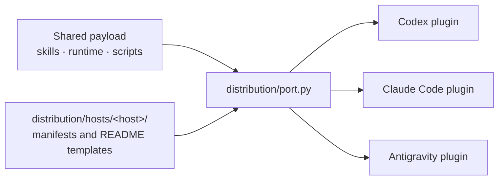

# Agent Factory plugin source

This repository is the single source for the Agent Factory plugin. Host
distributions are generated from it and must not be edited directly.

| Path | Contents |
|---|---|
| `skills/` | Host-neutral Skill documents (`agent`, `convention`, `document`, `tool`) |
| `runtime/storage/` | Runtime home, paths, persistence, public state, errors and migration |
| `runtime/system/` | OS seams and process lifecycle: transport, containment, sandbox, Windows/macOS, pinned Archify renderer |
| `runtime/execution/` | One agent turn: CLI, requested options, policy, prompts, images, usage, streaming, worktrees, Goal state, Interview events, document context, lesson capture and facts |
| `runtime/tasks/` | Task modes, bindings, announcements, allocation and model recommendation (`model-affinity.json`), plan receipts, loop progress, conductor and control-center views, operation records and supervision, domains, Work Units, integration checks and commits |
| `runtime/contracts/` | Receipt and capability contracts and their preflight |
| `runtime/runs/` | Run lifecycle: records, worker launch, attempts, and inspection/control commands |
| `runtime/adapters/` | Provider adapters (`codex`, `claude`, `antigravity`) |
| `scripts/` | Command entrypoints: `exec.py`, `loop.py`, `conductor.py`, `coordination.py`, `commit.py`, `domains.py`, `operation_records.py`, `lessons.py`, `archify.py` and the document tools |
| `distribution/package.json` | Shared name, version, description and host repositories |
| `distribution/hosts/<host>/` | Host-only manifests and README templates |
| `distribution/port.py` | Generator for every host distribution |
| `distribution/release.py` | Release coordinator across the plugin source and every host checkout (`plan`, `commit`, `push`) |
| `distribution/tool_usage.py` | Generates `skills/tool/references/usage/` from each script's argparse definition (`--check`) |
| `distribution/skill_budget.py` | Reports and enforces Skill document token budgets (`--check`) |
| `tests/` | Test suite for the source tree and generated layouts |

## How distributions are produced



## Generate host distributions

```sh
python3 distribution/port.py --out dist            # every host into dist/<host>/
python3 distribution/port.py --host claude --out ../agent-factory-claude-plugin
python3 distribution/port.py --host codex --out ../agent-factory-codex-plugin --check
```

Generated hosts:

- Codex: <https://github.com/KoreanLeeChangHyun/agent-factory-codex-plugin>
- Claude Code: <https://github.com/KoreanLeeChangHyun/agent-factory-claude-plugin>
- Antigravity: <https://github.com/KoreanLeeChangHyun/agent-factory-antigravity-plugin>

Adding a host means adding `distribution/hosts/<host>/` templates and a
`hosts.<host>` entry in `distribution/package.json`; the payload stays shared.

## Test

```sh
python -m pip install -r requirements.txt
python -m pytest tests -n auto --maxprocesses=4 --dist=worksteal
python -m ruff check --no-cache
```

- Run a small selection serially with `-n 0`. `tests/benchmarks/` holds performance
  measurements that are run explicitly.
- After adding or changing a script or its arguments, run
  `python3 distribution/tool_usage.py` to regenerate `skills/tool/references/usage/`.
