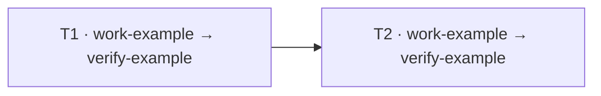

# Work contract example

<a id="sample"></a>

## 4. Sample contract

- The paths and specification below are illustrative, not inspected project facts.

### 4.1. 계약 정보

| Field | Value |
|---|---|
| Contract ID | `WC-example` |
| Version | 1 |
| Project root | `/example/project` |
| Governing specification | None identified in this example |

### 4.2. 작업 고용

| Agent ID | Role |
|---|---|
| `main-example` | Main: coordination and execution record |
| `work-example` | Work: implement T1 and T2 |
| `verify-example` | Verification: independently check T1 and T2 |

### 4.3. 작업 목표

| Task ID | Agent IDs | Work and boundary | Completion criteria |
|---|---|---|---|
| T1 | `work-example`, `verify-example` | Add task selection | Individual and all-item selection can be set and cleared |
| T2 | `work-example`, `verify-example` | Submit selected tasks | Only selected tasks are submitted; an empty selection does not execute |

### 4.4. 제약 조건

| Task ID | Kind | Constraint or dependency |
|---|---|---|
| T2 | Dependency | T1 must finish before T2 starts |

### 4.5. 파일 구조

- `+` means add; `-` means delete; `+/-` means modify. A move states source and
  destination explicitly. Each path also appears as an exact file operation in the
  machine-bound file list or attachment.

```text
Path / tree                    Change  Task ID  File goal
src/
├── ui/
│   └── TaskList.tsx             +/-     T1      Selection controls
├── state/
│   └── taskSelection.ts         +       T1,T2   Selection state
└── actions/
    └── submitTasks.ts           +/-     T2      Submit selected tasks
```

### 4.6. 작업 순서



<!-- contract-execution-record -->

### 4.7. 실행 기록

- The actual contract file starts this separate section empty and Main records
  bound execution IDs and evidence here as work proceeds.
